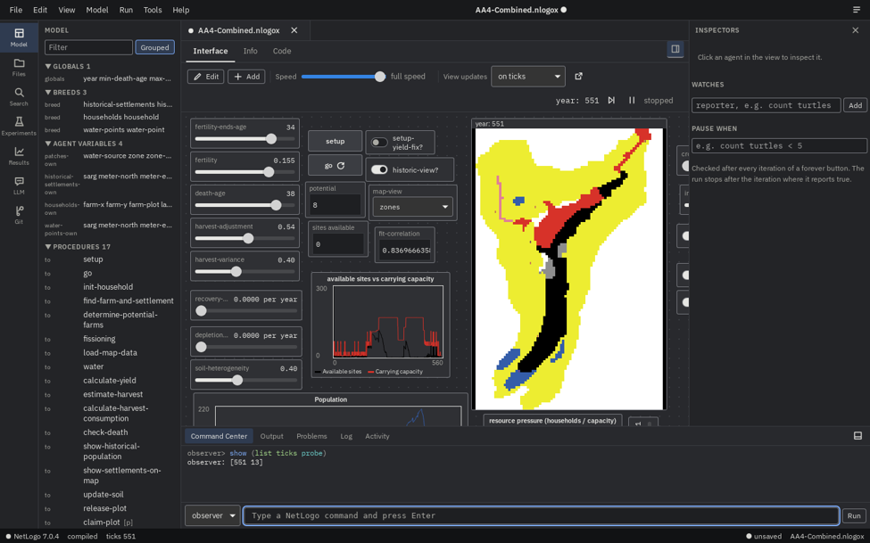

# Logos

Logos is a development environment for agent-based models written in NetLogo. It reads and writes NetLogo's `.nlogox` format without loss and runs models on the real NetLogo engine, so a model written for teaching can be extended into a research study without being rewritten.

> **Warning: usable, but under active development.**
>
> Logos can open, edit and run models today, but it is early software (version 0.0.0). Expect bugs, missing features and changes that break things between commits. Specifically:
>
> - **Back up your models first.** Logos edits `.nlogox` files in place when you save. The file writer is tested to be lossless on a large corpus of models, but it has not had wide use. Work on copies, or keep your models in git.
> - **Windows is the only platform it has been run on.** The code is written to build on macOS and Linux, but none of that has been measured.
> - **There is no installer and there are no releases.** You build it from source (see [Building and running](#building-and-running)).
> - **You need NetLogo 7.0.4 installed.** Logos runs models on NetLogo's own engine and does not download or bundle it.
> - **Phase 3 is about to start.** Features, file formats Logos writes next to your models (`logos.toml`, data dictionaries), and the protocol between the app and the engine can all still change.
> - **No stability promise.** Don't depend on Logos for work you can't redo.



*The Logos desktop app running AA4-Combined (a modified Artificial Anasazi model) on NetLogo 7.0.4, at tick 551.*

## Where the project is

Logos is built in phases. Each has a specification, success criteria and a results file.

| Phase | Content | Status |
|---|---|---|
| 0 | Technical spikes: the JVM bridge and live view, the lossless file format and parser | Done |
| 1 | Core: projects, BehaviorSpace experiments with Parquet output and provenance, secrets, the NetLogo parser, the language server, the `logos` command line | Done on Windows |
| 2 | Desktop app | Built; verification on Windows is in progress |
| 3 | Programmatic access (local API, Python client, MCP server), analysis through Python, experiment designs beyond BehaviorSpace, an LLM bridge for models, an in-app assistant, notebooks | About to start; it begins with a specification, and nothing in it is built yet |
| 4 | A native engine for models that don't need NetLogo-only features | Outline |

Details are in the [roadmap](docs/roadmap.md).

## What works now

The desktop app opens a `.nlogox` model and shows it as NetLogo does, then adds tools around it.

- **Model screen.** Interface, Info and Code tabs. The view is NetLogo's own rendering. Buttons, sliders, switches, choosers, monitors and plots work while the model runs. The speed slider, "view updates on ticks" and a "Pause when" condition act on a run in place.
- **Code editor.** Diagnostics, completion and rename come from NetLogo's own compiler through a language server. Apply recompiles the code and keeps the running world, and tells you what would be lost (removed variables or breeds) before it does anything.
- **Interface editing.** Move, resize, add and delete widgets, edit their properties and the world settings. One undo history covers code, Info, interface and experiments.
- **Inspection.** Inspect agents, set watches, run commands in the Command Center. Reading values never changes a run's random numbers.
- **Experiments.** Edit BehaviorSpace experiments in the model, run them on parallel workspaces, follow progress on a dashboard, and read results as NetLogo-compatible tables or Parquet.
- **Search and replace** across code, Info and widgets, with a preview of each replacement.
- **Projects.** A `logos.toml` beside the model lists its data files, Python requirements and secret names. Data files open as tables with an editable data dictionary.
- **Secrets.** API keys and similar values go in the operating system's credential store or an encrypted file. They are never written to model files, logs or crash reports.
- **Recovery.** Autosave every 30 seconds, restore after a crash, and a prompt when another program changes the model on disk.
- **Accessibility.** Keyboard access to every action through the command palette, and a text description of the view for screen readers (not yet tried with NVDA).
- **Themes.** Several built-in themes and a custom theme mode.

The `logos` command line runs and checks models and experiments without the app.

## Known limitations

- `.nls` files don't open as documents yet.
- Chooser choices can't be edited, because the way NetLogo 7.0.4 writes number, boolean and list choices hasn't been confirmed.
- An experiment can't get a stop condition or time limit added, and a model with no experiments can't get a first one, for the same reason.
- There is no automatic layout command for widgets.
- The operating system doesn't yet ask you to confirm before a secret is shown.
- Observer forever buttons run. Agent forever buttons and several runs at once don't.
- Several Windows measurements are still open (listed in [Phase 2 results](docs/phase-2-results.md)).
- macOS and Linux are untested.

## Requirements

- Windows. (macOS and Linux are untested.)
- [NetLogo 7.0.4](https://ccl.northwestern.edu/netlogo/download.shtml), installed in its default folder, or its location set in `LOGOS_NETLOGO_HOME`. Other NetLogo versions aren't supported.
- To build from source: Rust (stable, 1.97 or later), Node.js 22 or later, and a JDK 17 or later. On Windows, Rust also needs Visual Studio Build Tools 2022 with the "Desktop development with C++" workload.

## Building and running

```
git clone https://github.com/well-noted/Logos.git
cd Logos

# 1. The bridge between Logos and NetLogo (needs NetLogo 7.0.4 installed)
cd bridge
.\gradlew.bat jar
cd ..

# 2. The app's front end
cd app
npm ci
npm run build
cd ..

# 3. The app
cargo run -p logos-app --release
```

Open a model from the launcher, or pass one on the command line: `logos-app path\to\model.nlogox`. The repository includes AA4-Combined in `corpus/own/aa4-combined/`.

The first launch checks for NetLogo and the engine. If it can't find NetLogo 7.0.4, set `LOGOS_NETLOGO_HOME` to the install folder. Full build and test commands, and how Logos finds NetLogo, are in [Repository layout and Windows build](docs/repo-layout.md) and [app/README.md](app/README.md).

An installable .exe has also been prepared [here](https://github.com/well-noted/Logos/releases/download/v0.0.0/Logos_0.0.0_x64-setup.exe)

## Reporting problems

Bug reports are welcome. Say what you did, what you expected and what happened, and attach the model if you can share it. Don't attach files that contain keys or other secrets.

## Documents

- [Roadmap](docs/roadmap.md)
- [Decision log](docs/decisions.md)
- [Repository layout and Windows build](docs/repo-layout.md)
- [Bridge protocol](protocol/PROTOCOL.md)
- [Phase 0 specification](docs/phase-0-spec.md) and [results](docs/phase-0-results.md)
- [Phase 1 specification](docs/phase-1-spec.md) and [results](docs/phase-1-results.md)
- [Phase 2 specification](docs/phase-2-spec.md) and [results so far](docs/phase-2-results.md)

## License

The Rust code, protocol, Python client and documentation are dual-licensed under either of

- MIT license ([LICENSE-MIT](LICENSE-MIT))
- Apache License, Version 2.0 ([LICENSE-APACHE](LICENSE-APACHE))

at your option.

The JVM bridge in `bridge/` runs inside the same process as NetLogo and is licensed GPL-3.0-or-later. See [decision D-01](docs/decisions.md).

Models under `corpus/` keep their own licenses, stated in each model's folder. AA4-Combined is licensed CC BY-NC-SA 3.0, which restricts commercial use.

NetLogo is copyright Uri Wilensky and is distributed under the GNU General Public License. Logos is not affiliated with the NetLogo project or Northwestern University.
